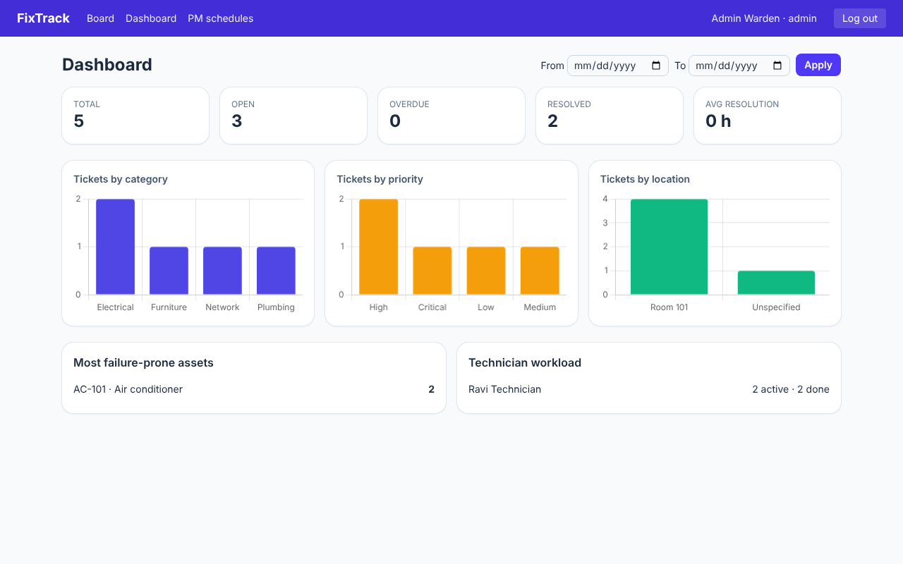
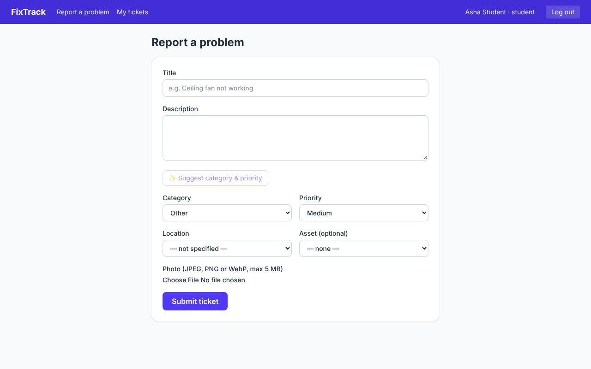
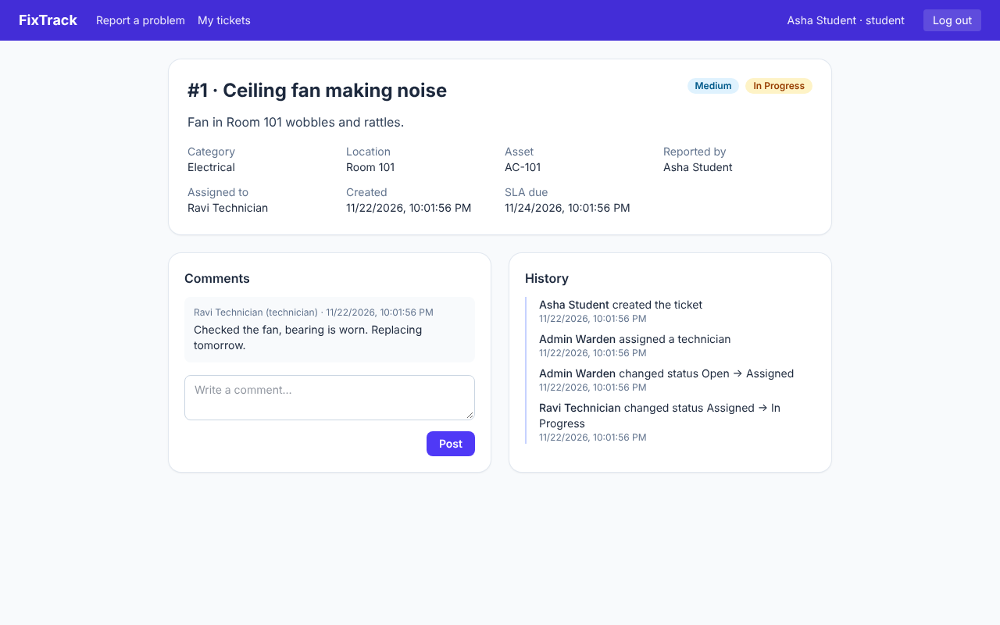
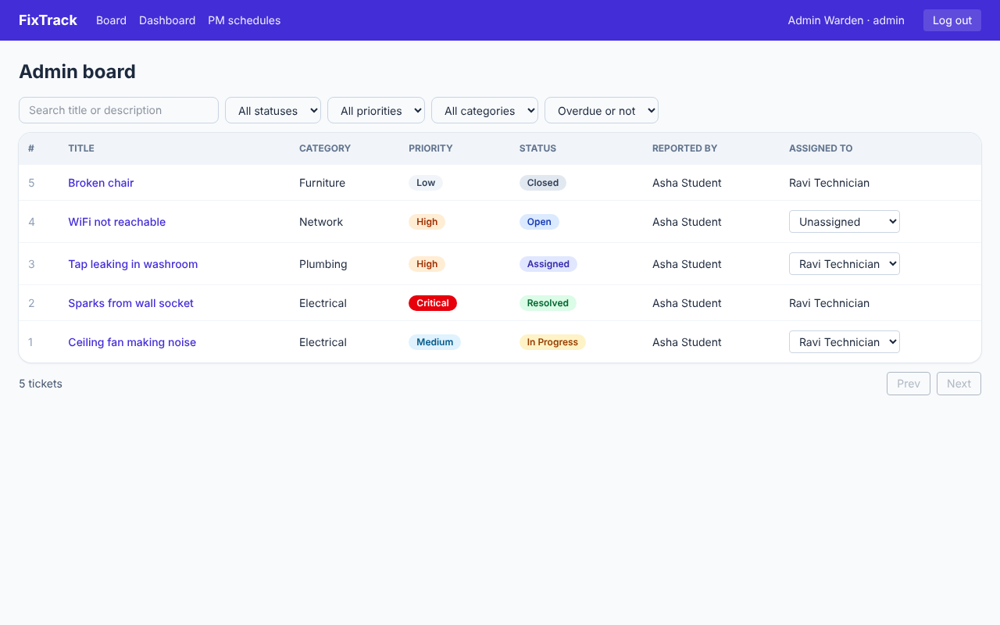
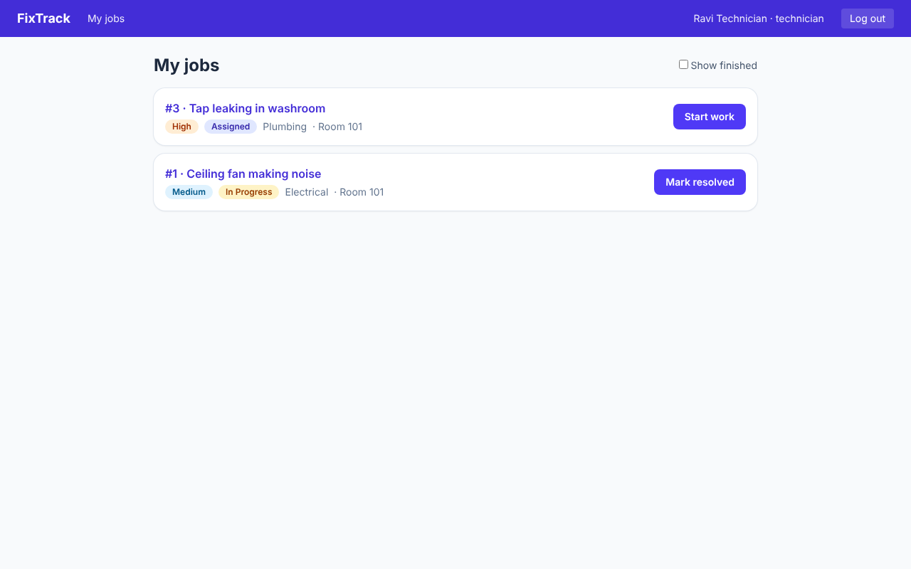

# FixTrack

Campus / hostel maintenance ticketing system. Students report problems, technicians fix them,
admins assign work, track SLAs and view analytics.

**Stack:** Vue 3 + Vite + Pinia + Tailwind + Chart.js · Node.js + Express · PostgreSQL · Redis · Claude API · Docker · GitHub Actions

Built step by step following `FixTrack_Project_Plan.xlsx` (one commit per roadmap step).



## Roles
| Role | Can do |
|---|---|
| Student | Report problems (with photo), track own tickets, comment, confirm fixed or reopen |
| Technician | See assigned jobs, update status, add notes (including internal notes) |
| Admin / Warden | See all tickets, assign technicians, manage users, assets, locations, PM schedules, view analytics |

## Features
- JWT auth with bcrypt, role-based access on every route, route guards in the UI
- Ticket lifecycle (Open → Assigned → In Progress → Resolved → Closed / Reopened) with a full history log
- Search, filters and pagination; comments and internal notes; photo upload (JPEG/PNG/WebP, 5 MB)
- SLA deadlines per priority with an automatic overdue flag (cron job) and overdue filter
- Claude-powered category/priority suggestion and duplicate detection (optional, fails open)
- Redis rate limiting on login/register, Helmet, CORS, Zod validation, centralized error handling
- Recurring preventive-maintenance schedules that auto-create tickets
- Admin dashboard: counts, average resolution time, breakdown charts, failure-prone assets, technician workload
- Jest/Supertest backend tests, Vitest frontend tests, GitHub Actions CI, Docker Compose

## Quick start (Docker)
```bash
docker compose up --build
# app: http://localhost:8080   api: http://localhost:4000/health
docker compose exec backend node src/db/seed.js   # optional demo users and data
```
Set `ANTHROPIC_API_KEY` (and a real `JWT_SECRET`) in your shell or a `.env` next to `docker-compose.yml` to enable AI features.

## Local development
Requirements: Node 22+, PostgreSQL 16, Redis 7 (Redis optional: an in-memory limiter is used if `REDIS_URL` is unset).

```bash
docker compose up -d db redis          # or use your own Postgres/Redis
cd backend
cp .env.example .env                   # edit if needed
npm install
npm run migrate && npm run seed
npm run dev                            # API on :4000

cd ../frontend
npm install
npm run dev                            # app on :5173, proxies /api to :4000
```

Demo logins after seeding (password `password123`): `admin@fixtrack.dev`, `tech@fixtrack.dev`, `student@fixtrack.dev`.

## Tests
```bash
cd backend  && npm test    # needs Postgres; uses database fixtrack_test (TEST_DATABASE_URL to override)
cd frontend && npm test
```
CI runs both on every push (`.github/workflows/ci.yml`).

## Project layout
```
backend/   Express API: src/routes, src/middleware, src/services, src/jobs, src/db/migrations, tests
frontend/  Vue 3 SPA: src/views, src/components, src/stores, src/api, tests
docs/      architecture.md and screenshots
```
See [docs/architecture.md](docs/architecture.md) for diagrams.

## Screenshots
| Report a problem | Ticket detail |
|---|---|
|  |  |
| **Admin board** | **Technician jobs** |
|  |  |

## API overview
`/auth/*`, `/tickets` (+ `/:id/status|assign|comments|events|attachments`), `/locations`, `/assets`, `/users`,
`/pm-schedules`, `/ai/triage`, `/ai/duplicates`, `/dashboard/summary|by-category|failing-assets`, `/health`.

## Deployment (free tiers)
1. **Neon** – create a PostgreSQL project, copy the connection string (`...?sslmode=require`).
2. **Upstash** – create a Redis database, copy the `rediss://` URL.
3. **Render** – New → Blueprint, point at this repo (uses `render.yaml`). Set `DATABASE_URL`, `REDIS_URL`, `CORS_ORIGIN` and optionally `ANTHROPIC_API_KEY`. Migrations run on every start.
4. **Vercel** – import the repo with root directory `frontend` (framework: Vite). If your Render service URL differs from `https://fixtrack-api.onrender.com`, update the destination in `frontend/vercel.json`.
5. Set `CORS_ORIGIN` on Render to the Vercel URL. Optionally run `node src/db/seed.js` once from the Render shell for demo users.

Note: Render's free web service sleeps when idle, and ticket photos are stored on local disk there (ephemeral). Use Cloudinary/S3 for durable photos in production.
