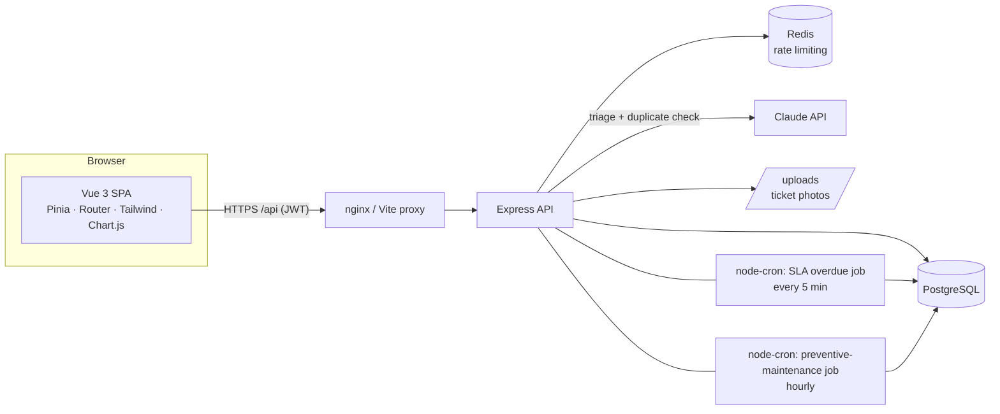
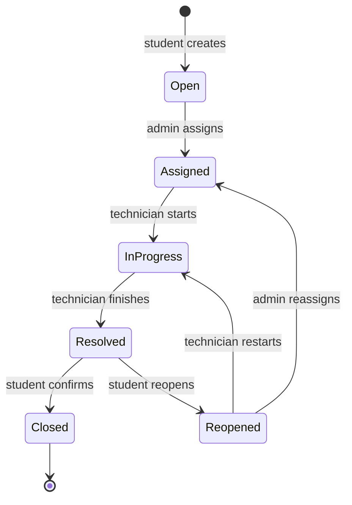
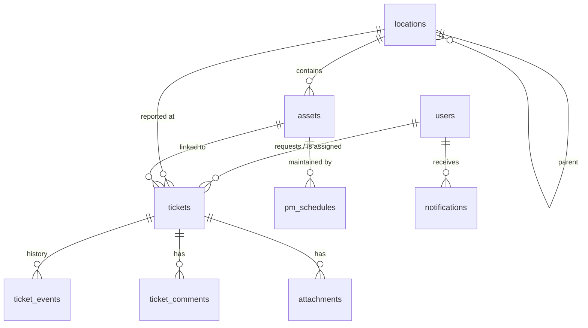

# FixTrack architecture

## Ticket lifecycle

## Entity relationships

## Key design decisions
- **Role scoping in SQL**: students only see their own tickets, technicians only assigned ones; enforced in every query, not just the UI.
- **Status transitions are a table** (`TRANSITIONS` in `routes/tickets.js`) mapping from/to status to allowed roles; every change writes a `ticket_events` row.
- **AI is optional**: Claude failures, timeouts or a missing key return "no suggestion" and never block ticket creation.
- **Rate limiter fails open**: if Redis is down, requests pass instead of locking everyone out.
- **PM job is idempotent**: `FOR UPDATE SKIP LOCKED`, and missed runs are skipped rather than flooding tickets.
- **SLA hours**: Critical 4h, High 24h, Medium 48h, Low 7 days.
